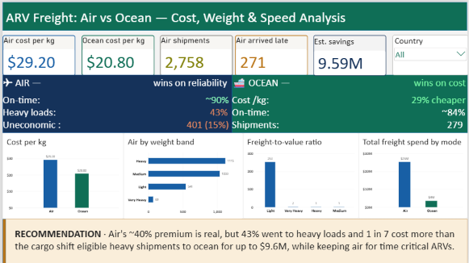

# SCMS Air vs Ocean Freight Analysis

**Were we paying for air speed we didn't need?**

This project looks at antiretroviral (ARV) shipments from the USAID/PEPFAR Supply Chain Management System and compares air freight against ocean freight on cost, weight, and delivery speed. The goal was to find out where air was used when it didn't need to be, and how much money that cost.

## The question

Air freight costs a lot more than ocean, but it often gets used by default when people want things to arrive quickly. I wanted to check whether ARV shipments were being flown when ocean would have done the job, and put a number on what that was costing.

## Data

The data is the USAID/PEPFAR SCMS "Supply Chain Shipment Pricing Data" from Kaggle (file name `SCMS_Delivery_History_Dataset.csv`). It has 10,324 shipment records across 33 columns. I focused the analysis on ARV products, air and ocean modes, and rows that had usable weight and freight values.

## Tools I used

I used a different tool for each stage, picking whatever fit the job best.

* **Excel** for cleaning. The weight and freight columns had text mixed in (things like "Weight Captured Separately"), so I built a flag for usable rows and added columns for cost per kg, weight band, and delay days.
* **SQL (SQLite)** for the main analysis. I answered each of my questions with GROUP BY and WHERE queries.
* **Python (pandas)** to double check the SQL results matched and to plot a couple of distributions.
* **Power BI** to build the dashboard, including the KPIs, a DAX measure for the savings, and a country filter.

## What I found

| Question | Finding |
|----------|---------|
| Is air a lot more expensive? | Air costs about 40% more per kg than ocean ($29.20 vs $20.80). On a total dollar basis the gap is bigger, closer to 2.6 times. |
| Was air used for heavy loads? | Yes. 43% of air freight went to heavy shipments, which is exactly where ocean is cheapest. |
| Was cheap cargo flown? | 401 air shipments (about 1 in 7) cost more in freight than the cargo itself was worth. |
| Did air actually arrive faster? | Not really the issue I expected. Air was more reliable, around 90% on time versus 84% for ocean. |
| Could we have saved money? | Shifting the heavy air shipments to ocean could have saved roughly $9.6M. |

The honest version of the story is not "air is bad". Air does cost more, and a lot of it went to shipments where that cost was hard to justify, but it also delivered more reliably. So it comes down to a trade off rather than a simple yes or no.

One thing worth flagging: the 40% figure is an average of each shipment's ratio. If you weight it by actual dollars and kilograms, air comes out around 2.6 times ocean, because small light shipments carry very high per kg costs. How you calculate the average changes the answer, which is worth being clear about.

## Recommendation

Air's premium is real, but 43% of it went to heavy loads and 1 in 7 shipments cost more than the cargo was worth. Shifting the eligible heavy shipments to ocean could save up to $9.6M, while still keeping air for the ARVs that genuinely need to move fast.

## Files

| File | What it is |
|------|-----------|
| `SCMS_analysis.sql` | The SQL queries |
| `SCMS_analysis.ipynb` | The Python notebook |
| `SCMS_dashboard.pbix` | The Power BI dashboard |
| `dashboard.png` | A screenshot of the dashboard |
| `SCMS_clean.csv` | The cleaned data |

## Things to keep in mind

* The ocean sample is small (279 shipments against 2,758 air), so the ocean numbers are directional rather than solid.
* About 61% of records show the delivered date equal to the scheduled date, so the real on time rate is hard to confirm. The speed finding is real but limited by the data.
* The $9.6M is an estimate using ocean's heavy band rate. The actual amount you could recover depends on how many of those heavy air shipments were genuinely urgent.
* I left out 17 rows with a zero cargo value from the freight to value check so the division wouldn't break.

This was my first full data analytics project, taking it from a raw messy file all the way to a finished dashboard.
